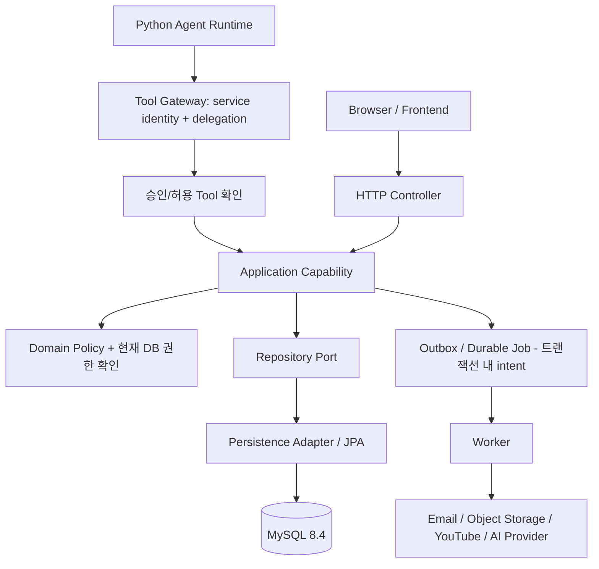

# Worship V1 — 시스템 아키텍처와 모듈 계약

> 상태: **구현 기준 설계 후보**. 제품 정책은 `PRODUCT_SPEC.md` 및 승인된 변경이 우선하며, `architecture-core.md`의 12개 요구를 준수한다. 코드·DB 실행·부하 검증 완료를 의미하지 않는다.

## 1. 설계 목표와 선택 근거

- **Spring Boot 단일 배포형 Modular Monolith**: V1의 팀 규모와 기능 간 DB 원자성을 고려해 마이크로서비스 운영 복잡도를 피하면서 도메인 소유권을 분리한다.
- **한 개의 비즈니스 규칙**: 브라우저와 Agent가 각자 권한과 저장 로직을 구현하지 않는다. 모두 동일한 Application Capability에 도달한다.
- **경계의 명확성**: 도메인 정합성은 Core Backend, 자유형 의도 해석은 Agent Runtime, 외부 효과는 Adapter/Worker가 맡는다.
- **미래 변경 가능성**: 외부 Provider는 Port/Adapter로 격리하며, Redis/Broker/마이크로서비스/범용 워크플로 엔진은 선제 도입하지 않는다.



**화살표 해석:** Controller와 Agent Tool Gateway는 '입구'이며 저장 규칙을 소유하지 않는다. Application은 유스케이스·트랜잭션의 중심, Domain은 허용 여부와 불변식, Infrastructure는 DB/외부 서비스를 연결한다. Worker는 오래 걸리거나 실패 가능한 외부 작업을 DB 커밋 뒤 처리한다.

## 2. 기능별 소유 모듈

| 모듈 | 책임과 소유 개념 | 외부에 공개하는 기능 예시 | 소유하지 않는 것 |
|---|---|---|---|
| `identity` | User, 로그인·세션·연결 자격증명 | 현재 사용자, 가입/탈퇴 상태 | Workspace 인가 |
| `workspace` | Workspace, Member, Team, TeamMember, 초대 | 공간 참여/팀 상태, 멤버 확인 | Document 내용 |
| `document` | Document, Owner, 권한, 요청, ViewLink | 권한 계산, 정책·소유권 변경 | 콘티 줄/곡 데이터 |
| `worship` | ServiceOccurrence, Template, 콘티 행/버전/Revision, Block 연결 | 회차·콘티 변경, 부분 저장/복원 | 로그인, 외부 YouTube 토큰 |
| `repertoire` | Workspace Song, Arrangement, Score, Reference, Block 원본* | 곡 조회·선택·악보 업로드 | Document 인가 결정 |
| `playlist` | YouTube 연결·Playlist와 동기화 | 재생목록 생성·재조정 | 콘티 원본 변경 |
| `notification` | 알림·메일 발송 의도 | 알림 생성/조회, 전달 결과 | 업무 데이터 소유권 |
| `orchestration` | 모듈 간 유스케이스 조합 | 탈퇴/관리자 교체 등 교차 기능 | Entity, Repository, 범용 workflow 엔진 |
| `agent-adapter` | Tool allowlist, 위임·승인 전달 | 승인된 명시적 도메인 Tool | 직접 SQL, Provider SDK |
| `platform` | JPA 구현, 보안·스토리지·HTTP Provider, Worker 기반 기술 | Port 구현 | 제품 정책 |

*`Block` 원본의 최종 코드 패키지 소유는 팀 구현 착수 시 repertoire 내 별도 하위 패키지로 고정할 후보이며, 송폼 section과 혼동하지 않는다.

**패키지 예시 (실제 생성된 코드가 아닌 목표):**

```text
com.worship
 ├─ identity/{api,application,domain,infrastructure}
 ├─ workspace/{api,application,domain,infrastructure}
 ├─ document/{api,application,domain,infrastructure}
 ├─ worship/{api,application,domain,infrastructure}
 ├─ repertoire/{api,application,domain,infrastructure}
 ├─ playlist/{api,application,domain,infrastructure}
 ├─ notification/{api,application,domain,infrastructure}
 ├─ orchestration/application
 ├─ agentadapter/{api,application}
 └─ platform/{security,storage,worker,config}
```

## 3. 레이어 및 의존 규칙

| 레이어 | 하는 일 | 하지 않는 일 |
|---|---|---|
| API/Inbound Adapter | HTTP 입력 파싱, 기본 검증, 인증 주체 전달, 응답 변환 | 비즈니스 권한 판단/Repository 직접 호출 |
| Application | 유스케이스 단계, 현재 권한 재확인, 트랜잭션, idempotency, 저장 결과 조합 | HTTP/S3 SDK 세부 코드 포함 |
| Domain | Owner/Grant/상태/버전 불변식, 상태 전이 | Controller/ORM/외부 API 의존 |
| Port | 필요한 저장·외부 동작의 추상 계약 | 임의 엔티티/Repository를 다른 모듈에 노출 |
| Infrastructure/Outbound Adapter | JPA, SQL, OAuth/Email/Storage SDK, Provider 오류 매핑 | 제품 정책/도메인 인가 우회 |

- 한 모듈이 다른 모듈의 **Entity나 Repository를 직접 접근하지 않는다**. 공개된 Application 조회/명령 계약을 이용한다.
- 순환 의존을 만들지 않도록 교차 작업은 `orchestration`에서 구성한다. 같은 DB에서 필요한 원자적 갱신은 좁은 트랜잭션으로 묶는다.
- 웹은 server-side Session(Spring Session JDBC), CSRF 보호를 사용한다. Agent에는 브라우저 쿠키를 전달하지 않는다. Core가 발급한 단기 delegation과 서비스 신원을 확인하고 실제 변경 시 현재 DB 인가를 다시 확인한다.

## 4. 대표 흐름: 콘티 저장

1. `PATCH` 요청이 브라우저의 세션과 예상 버전(expectedVersion), command id로 도착한다.
2. Controller가 구조 검증 후 `worship.application` Capability를 호출한다.
3. `document` 공개 권한 계약으로 현재 Member/Document 권한을 확인한다. RESTRICTED에 대한 ADMIN 우회는 없다.
4. 변경 유형에 맞는 잠금·버전 비교 후 충돌 없는 단위만 갱신한다. 구조 순서는 문서별 직렬화하여 검사한다.
5. 변경 데이터, Revision, 외부 처리 intent(필요한 경우)를 **같은 DB 트랜잭션**에 커밋한다.
6. 응답에는 단위별 성공·409 충돌, 신규 버전을 반환한다. UI는 충돌난 입력을 버리지 않는다.

**외부 효과 예시:** 악보 S3 업로드/YouTube 갱신/메일은 DB와 원자적으로 커밋할 수 없다. UploadIntent 또는 Job 기록을 기반으로 실패·재시도·재조정한다. CPU/GPU 실행도 HTTP 트랜잭션과 분리한다.

## 5. 변경 시 영향 범위 (팀 협업 기준)

| 바꾸는 요구 | 먼저 수정할 곳 | 같이 확인할 곳 |
|---|---|---|
| 콘티 줄 이동/자동저장 | `worship.application/domain` | Document 인가, position version, Revision, 프론트 충돌 응답, SQL 인덱스/경쟁 테스트 |
| 문서 공개 범위/소유권 | `document.application/domain` | Member 상태 조회, ViewLink 노출, 현재 권한, 동시 요청 테스트 |
| 멤버 제명/팀 탈퇴 | `workspace.application` + 교차 흐름 | 문서 Owner/Team Grant/개인 제외, 계정 종료, 읽기/쓰기 인가 |
| 악보 용량·업로드 | `repertoire.application` + Storage adapter | UploadIntent, quota, 파일 ACL, Reconciliation |
| YouTube 연동 | `playlist.application` + Provider adapter | OAuth 분리, marker, DurableJob/idempotency, 부분 실패 |
| Agent Tool 추가 | `agent-adapter` allowlist + 공개 Capability | 기획서 §15.2, 승인/위임, payload hash, 실행 시 권한 |

## 6. `architecture-core.md` 12개 원칙 추적

| # | 설계 적용 | 개발 검증 기준 |
|---|---|---|
| 1 끝까지 실패 시나리오 | 정상/부분실패/취소/재시도/복구 명세 | 실패 주입 통합 테스트 |
| 2 Ontology 통일 | User/Member/Document/SetlistRow/Block 등 일관 용어 | DTO·Tool·DDL 명명 검사 |
| 3 Error → UX → 복구 | 오류 코드·입력보존·운영 경로 | HTTP/화면/로그 계약 테스트 |
| 4 계층·모듈 경계 | feature 패키지, Port, 공개 Capability | ArchUnit/모듈 순환 검사 |
| 5 AI Worker 경계 | 외부/고비용 작업 비동기·durable job | 중단/재시작·중복 실행 테스트 |
| 6 Tool 계층 | 의도 단위 Tool→Application, 승인 | allowlist·replay·인가 테스트 |
| 7 Community 제외 | V1 범위에 구현하지 않음 | 기능 목록 감사 |
| 8 Harness | 정본/결정원장/검증 게이트 유지 | PR 체크와 컨텍스트 복원 |
| 9 기능 단위 분업 | 소유 모듈과 기능별 API 계약 | 팀 작업 경계 검토 |
| 10 선택 근거 | 위 선택 이유·대안·검증 기준 | ADR/측정 결과 |
| 11 설계 vs 검증 | 상태 명시, 미실행 테스트 미표시 | CI 증거 첨부 |
| 12 과설계 방지 | 1개 배포, 필요한 경계만 분리 | 성능·장애 근거 없는 인프라 금지 |

## 7. 구현 전에 반드시 검증할 항목

MySQL 8.4 Flyway V001~V010 **빈 DB 적용은 미실행**. Spring Session JDBC 스키마 별도 확인, Testcontainers 권한/정렬 경쟁, ArchUnit 경계, OpenAPI·Agent 허용 기능 합의, 장애 주입 및 쿼리 EXPLAIN이 남아 있다. 이 문서는 팀 개발의 **방향과 경계**이지 구현 성공 인증이 아니다.
