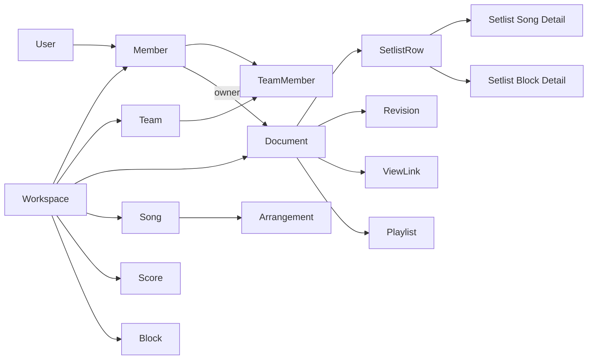

# Worship V1 — 데이터 모델·인가·동시성 계약

> 설계 정본 후보. 상세 DDL은 `sql/V001`~`V010`이지만 MySQL 8.4에서 실행하지 않았다. `PRODUCT_SPEC.md` 및 승인된 Overlay/후속 결정 우선.

## 1. 데이터 소유권 개요

- `Workspace`가 tenant 경계. **V1 Song은 Workspace 소유**, 서비스 전역 공용 카탈로그 없음. 같은 제목/가수의 중복 방지는 기획서 우선.
- `Document`가 소유/권한 경계이며 V1 종류는 SETLIST. 논리 `Setlist`는 별개 도메인 명칭이지만 **물리 SQL 후보에서는 `setlist` 테이블을 `document`로 흡수**, `setlist_structure_version`을 별도 보존한다.
- `SetlistRow`는 SONG/BLOCK 공통 순서. 각 행에 해당하는 단일 상세 행이 있어야 하며, DB 복합 FK는 **틀린 종류의 상세 행 삽입만 차단**한다. 정합한 상세 행 존재·정확히 하나 규칙은 Application transaction에서 보장/검증한다.
- `Block`은 Workspace 공용 텍스트 원본; 송폼 Verse/Chorus section과 **다른 개념**. 과거 Revision의 내용이 원본 변경으로 소급 변경되어선 안 된다.
- `Score`와 파일 객체·UploadIntent는 분리. DB rollback으로 S3 파일이 자동 삭제되지 않으므로 보상/고아파일 정리·재시도 상태를 보관한다.
- `Reference`, `Arrangement`를 Setlist 사용 맥락에 연결할 때 Song과 Workspace 일치가 필요하다.

## 2. workspace_id 채택 기준

| 테이블 종류 | 정책 | 이유 |
|---|---|---|
| Workspace의 독립 자원: Document/Song/Score/Block/Team/ServiceOccurrence | 유지 | 소유·tenant 격리 및 주 조회 경로 |
| 복수 부모 자원 연결: SetlistRow·상세·Playlist·ScoreAttachment | 필요할 때 유지 | `(workspace_id,parent_id)` 복합 FK로 **서로 다른 공간 연결 차단** |
| 단일 부모에 종속: 일부 Revision/Job 내부 기록 | 자동 추가 금지 | 부모 경유 식별 가능. 격리/조회/무결성 이점 입증 시만 사용 |

`workspace_id`가 있다는 사실만으로 접근 허용하지 않는다. `Member` 활성 여부 + Document의 권한 정책을 DB 현재 상태에서 계산한다.

## 3. 핵심 정책과 불변식

| 경계 | 반드시 유지할 규칙 | DB / Application 책임 |
|---|---|---|
| Workspace 관리자 | 활성 공간에 관리자 **1명**. 단일 출처 `workspace.admin_member_id` | FK와 갱신 트랜잭션; ACTIVE 상태·최후 관리자 불변식은 lock/도메인 검증 |
| Document Owner | `document.owner_member_id`; Owner 권리 ≠ Document Grant | 동일 공간 FK; 승계/강제 내보내기 원자성은 Application |
| OPEN / RESTRICTED | OPEN은 활성 멤버의 조회 허용, RESTRICTED는 승인 경로 필요. 관리자 자동 우회 없음 | 읽기/쓰기마다 통합 Authorization Policy |
| 직접·팀 권한 | MANAGER/EDITOR/VIEWER 합성, 전역 개인 제외 적용 | Grant/Exclusion 저장 + 현재 권한 계산 |
| 팀 삭제 | `Document × Member` 개인 제외는 계속 유지 | Team 삭제 시 exclusion 연쇄 삭제 금지 |
| 강제 제명 승계 | 개인 제외 상태라도 **직접 EDITOR**면 승계 후보 | 승인된 D-USER-01; 승계 시 권한/활성 검증 |
| 소유권 수락 대기 | 유효 MANAGER의 OPEN/RESTRICTED 변경 허용 | 승인된 D-USER-02; 실행 시 권한 검증 |
| 권한 요청 | Document 귀속, 현재 Owner/MANAGER가 승인 | 권한·상태·만료 재검증; OPEN 전환 시 VIEWER 종료/EDITOR 유지 |
| Row kind | SONG에는 SongDetail, BLOCK에는 BlockDetail만 | 복합 FK + create/restore/delete 트랜잭션 |
| 삭제·복원 | 과거 Revision의 의미/내용 불변; 잘못된 Block 자동 재연결 금지 | immutable snapshot + 복원 validation |

## 4. 동시성 계약

- 동일 콘티에서 **서로 다른 값/행의 저장은 불필요하게 전체 실패시키지 않는다.** 각 데이터 단위의 expectedVersion과 결과를 구분한다.
- 위치 변경은 문서 단위 잠금을 사용해 줄 전체 순서 계산을 직렬화한 후 `position_version` 검증·갱신한다. 교착·경합 비용을 Testcontainers로 검증해야 한다.
- **권한 회수 vs 저장**은 서로 다른 순간의 권한 스냅샷을 조합해 허용하면 안 된다. 지정된 락 순서와 실제 커밋 직전 재검증이 필요하다.
- 성공한 변경 + Revision 기록 + Outbox/Job intent를 같은 트랜잭션으로 저장한다. 외부 호출은 장기 DB 트랜잭션에서 실행하지 않는다.
- `Revision`은 변경 이력의 근거, UI의 5분 단위 묶음 표시는 표시 정책이다. ViewLink는 **현재 최신 읽기 전용**, PDF는 **동기 생성·응답**하고 서버에 PDF 파일/이력 테이블을 생성하지 않는다.

## 5. 테이블 과설계 방지

- 논리 개념과 물리 테이블 1:1 대응을 강제하지 않는다 (`Setlist` 통합 사례).
- 새로운 별도 테이블은 독립 생명주기/인덱스·무결성/대량 조회·쓰기 경합 중 하나로 근거를 제시해야 한다.
- Workspace ID, 상태값, 역참조 칼럼을 편의 목적으로 중복하지 않는다. 중복이 tenant composite FK에 필요하면 이유를 기록한다.
- V001~V010은 초안의 순차 수정본이므로 **운영 DB에 그대로 적용할 승격본이 아님**. 신규 빈 DB 실행·검증 후 배포 마이그레이션으로 정리한다.

## 6. 검증 우선순위

1. 빈 MySQL 8.4에 Flyway 연속 적용, `information_schema`로 FK/unique/check/생성열 검증.
2. 다른 Workspace 참조, 비활성 Member, 잘못된 SONG/BLOCK 상세, 소유권 무효 승계 **거부 테스트**.
3. 동시 `reorder`, 권한 회수/저장, 관리자 이전/탈퇴, 요청 승인/공개 변경, 알림 outbox 중복 소비.
4. 데이터 수·쿼리 패턴에 맞춘 EXPLAIN ANALYZE, N+1 감시, 잠금 경합/교착·재시도 확인.

**아직 미결정:** 과거 Revision에만 남은 악보 복원으로 용량을 초과할 때 허용/거절/정리 정책. 구현자가 임의 결정하지 않는다.
