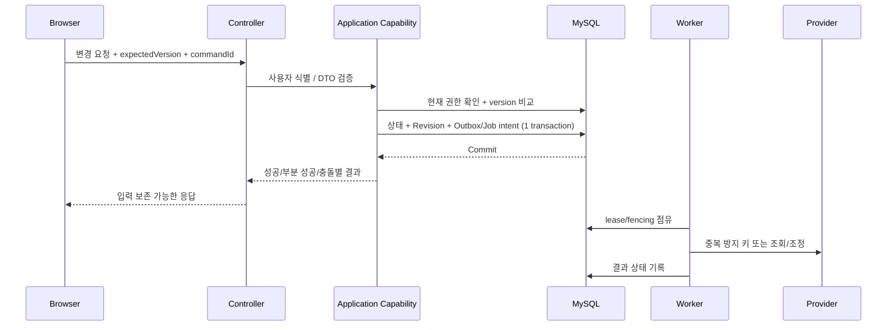

# Worship V1 — API·Agent·오류·Worker 계약

> 설계 후보 / 구현·OpenAPI·테스트 미완료. 사용자·팀과 협의하지 않은 endpoint 및 DTO 세부 형태는 확정값이 아니다.

## 1. 호출 규칙

- 상태 변경은 API/Agent 모두 **Application Capability**를 호출한다. `Tool = SQL 한 문장`이 아니다.
- 인증(Authentication)과 권한(Authorization)은 다르다. Browser Session으로 사용자 확인 후에도 Workspace/Document 권한은 DB 현재 상태로 평가한다.
- 재시도 가능한 변경은 command id로 중복 요청을 식별한다. Provider 호출 응답 유실은 내부 command id만으로 해결되지 않으므로 **외부 재조회·reconciliation**이 필요하다.

## 2. Capability 그룹 / 모듈 책임

| 그룹 | 동작 예시 | 검증 포인트 |
|---|---|---|
| Identity / Account | 가입, 로그인, 메일 인증/변경, 탈퇴/복구 | 계정 존재 비노출, 세션 폐기, outbox |
| Workspace / Team | 공간 생성, 초대/참여, 구성원 관리, 팀 | 활성 ADMIN/Member, 정합한 승계 |
| Document | 생성, 열람, 권한 요청, Owner·공개 정책 변경 | RESTRICTED 관리자 우회 금지 |
| Worship / Setlist | 회차·템플릿, 행 추가/순서/부분 저장/복원 | per-unit version, Revision, block 처리 |
| Repertoire | 곡/편곡/악보/Reference/Block | tenant isolation, MIME/저장소 실패 |
| Export / ViewLink | 최신 읽기 전용 링크, 즉시 PDF 생성 | 권한 경계, PDF 영속 저장 금지 |
| YouTube | 계정 연결, 검색, Playlist 생성/수정 | 최소 OAuth scope, marker/reconciliation |
| Notifications | 수신함/상태, 보안 알림, 메일 | 개인정보 비노출, 재시도/90일 보존 |

기능 표는 **업무 능력의 목록**이며 HTTP URI 확정표가 아니다. Controller DTO, Error schema, OpenAPI는 구현 시 일치시켜야 한다.

## 3. Agent Runtime / Tool Gateway

1. 브라우저는 Core Backend의 Session만 소유한다. Agent Runtime에는 Browser cookie/session을 전달하지 않는다.
2. Core가 단기 delegation을 만들고 Agent service identity와 함께 Gateway에서 검증한다.
3. Agent가 사용할 수 있는 Tool은 `PRODUCT_SPEC.md §15.2`의 **명시적 allowlist**만 제공한다. 전체 백엔드 API 자동 노출 금지.
4. 읽기·검색은 안전한 Capability로 즉시 실행 가능하나 **상태 변경은** `prepare → preview → approvalId → execute` 순서로 수행한다.
5. 승인 식별자는 actor, action, 정규화한 payload/hash, target/version, expiry와 결합. 변조·재사용·만료는 차단하고 실행 시 **현재 DB 권한을 재검증**한다.
6. LLM의 자연어 해석·후보 비교와 도메인 쓰기는 분리한다. SQL/Repository/Provider SDK 직접 연결 금지.

## 4. 오류 → 화면 → 운영 복구

| 상황 | API의 의미 | 프론트 요구 | 운영/서버 처리 |
|---|---|---|---|
| 로그인 만료 | 401 | 로그인 유도, 편집 입력 보존 가능하면 유지 | 비밀 정보 로깅 금지 |
| 문서 접근 불가 | 403 또는 노출 방지용 404 | 제한 문서 제목 등 존재 정보 노출 금지 | 현재 DB 권한 재확인 |
| 버전 경쟁 | 409 + 충돌 단위·최신 버전 | 성공 단위 유지, 충돌 입력 보존/재선택 | CAS/락 경합 추적 |
| 중복 command 다른 payload | 409 | 요청 새로 생성/충돌 안내 | 동일 id 다른 해시 거절 |
| 비동기 수락 | 202 + jobId | 진행/실패/불확실 상태 조회 | Durable Job lease·재시도 |
| Provider 응답 불명확 | 202/상태 조회 경로 | 무조건 다시 생성하지 않음 | marker·external lookup 조정 |
| 외부 저장 실패 | 명시적 실패/재시도 | 업로드 현황 표시 | UploadIntent·고아 정리 |

코드·HTTP 지위는 **요구되는 의미의 설계 계약**이다. 구체적인 오류 enum/DTO는 API 명세와 테스트로 확정한다.

## 5. Outbox vs Durable Job

- **Outbox:** 커밋된 도메인 사건을 안전하게 전달하기 위한 기록.
- **Durable Job:** 실제 실행 대기/점유/시도/결과/재시도/복구를 관리하는 단위.
- `lease`, `fencing token`, backoff, 최대 시도 및 terminal failure, 죽은 Worker 재점유를 정의한다.
- 메일/Storage/YouTube는 처리 중 장애가 발생할 수 있으므로 exactly-once 실행을 약속하지 않는다. DB 커밋과 외부 서비스 호출의 차이를 재조정한다.
- 고비용 CPU/GPU 작업은 배포 자원이 팀 합의 전이며, 향후 별도 Worker 배치 가능하도록 Port+Job 계약만 고정한다.

## 6. 팀 개발의 Done 기준

기능을 구현했다고 완료로 보지 않는다. 최소 단위는 정상·권한·다른 Workspace·충돌·실패·재시도·관측·문서 계약까지 포함한다.

- [ ] 해당 모듈 소유권/공개 Capability 준수, 순환 의존 없음
- [ ] 승인된 제품 정책과 일치, DTO/Tool/DB 명칭 일관
- [ ] MySQL Flyway + Testcontainers 실패/동시성 검증
- [ ] CSRF/세션·인가 검증, 비밀정보/존재 여부 노출 차단
- [ ] 외부 응답 유실·중복/Worker 중단 테스트
- [ ] 쿼리/잠금 비용 증거와 오류→UI 행동 명세

**미해결 운영 의사결정:** AI 실행 비용/Worker 위치, Agent 대화 보존 기간, Revision-only Score 용량 초과 정책. 제품 담당자와 별도 합의 필요.
